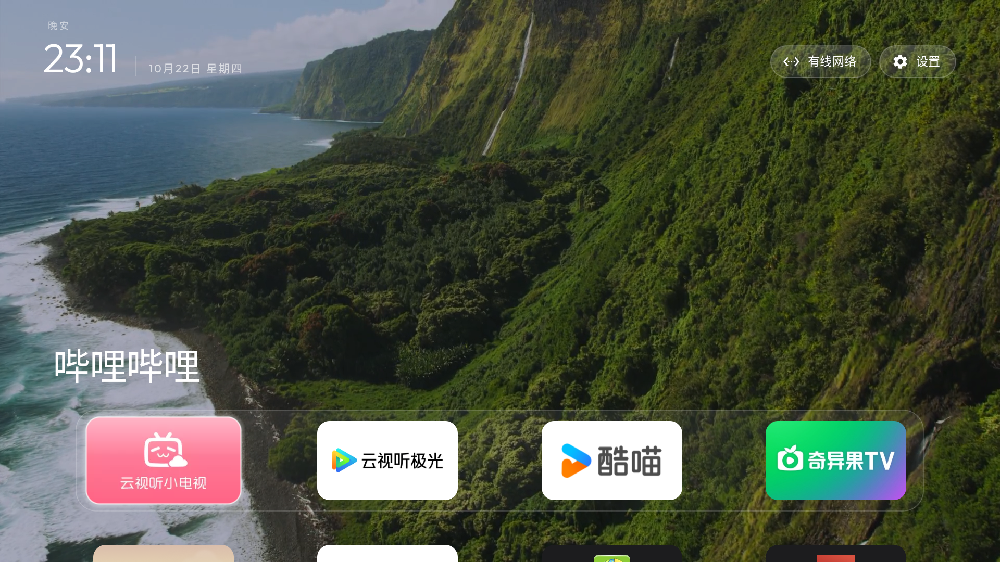

# Local-video Home and Netflix remote pointer

An independently maintained fork of [CleanYourTV](https://github.com/Gathin23/cleanyourtv),
starting from upstream commit `22dc48fe21b1618f9b2fae448d991271d1d7277e`.
It publishes two source projects used during one owner-authorized TCL/FFALCON TV
configuration session. Neither feature is proposed for the small upstream launcher.

- [Video wallpaper and Home lifecycle](launcher/app/src/main/java/com/gathin/tvhome/VideoWallpaperPlayer.java)
- [Independent mobile Netflix remote pointer](companions/netflix-remote/README.md)
- [Report a problem](https://github.com/iloveOREO/cleanyourtv/issues) and identify the
  `tv/local-video-wallpaper-and-pointer` branch in your report.

## What the launcher changes

A local `wallpaper.mp4` plays silently under the existing launcher UI. It loops,
center-crops without stretching, releases MediaPlayer on Activity pause or screen
sleep, and resumes its saved in-process position when Home returns. A missing or
unplayable file falls back to the static wallpaper. There is no download feature,
Internet permission, analytics, subscription configuration or bundled video.

The branch also contains the session's `BootHomeActivity` (direct-boot-aware HOME
entry) and `BootHomeReceiver` (a single delayed launch after normal boot). The
public receiver only launches when this app is still the selected HOME. It is
not a persistent foreground/background service. Stock Home remains installed and
enabled; the firmware's boot timing still varies by device.

## Build from source

Clone this explicit feature branch (the fork default branch is not this project):

```sh
git clone --single-branch --branch tv/local-video-wallpaper-and-pointer https://github.com/iloveOREO/cleanyourtv.git
cd cleanyourtv
```

Requires JDK 17, Android SDK platform/build-tools 34, and the checked-in Gradle
wrapper (8.12, with the official distribution checksum). From the repository root:

```sh
export JAVA_HOME=/path/to/jdk-17
export ANDROID_HOME=/path/to/android-sdk
./launcher/gradlew -p launcher --no-daemon testReleaseUnitTest lintRelease assembleRelease
./launcher/gradlew -p companions/netflix-remote --no-daemon lintRelease assembleRelease
```

Build outputs stay local. The projects use the local Android debug signing key
for sideloading; no keystore or prebuilt APK is published. An update must use the
same signing key as the previous installation. Do not remove an app or its data
merely to avoid a signature mismatch.

## Install and select Home

Use an owner-authorized ADB serial and the normal installation path permitted by
your TV. Set `TV_ADB_SERIAL` explicitly; no personal TV address is supplied here.
Back up current HOME, screensaver and AppOps states privately before changing them.

```sh
adb -s "${TV_ADB_SERIAL:?Set the authorized device serial}" install -r launcher/app/build/outputs/apk/release/app-release.apk
adb -s "$TV_ADB_SERIAL" shell am start -n com.gathin.tvhome/.MainActivity
```

If installation is rejected by firmware verification, stop. This fork does not
provide a verifier bypass, installation-policy modification, system-package disable
or firmware unlock. Installation success on the session's TV does not establish
that another TV accepts this APK through ordinary ADB.

Only after the app opens and the physical remote works, select its Home entry:

```sh
adb -s "$TV_ADB_SERIAL" shell cmd package set-home-activity --user 0 com.gathin.tvhome/.BootHomeActivity
```

On the observed TCL firmware, the launcher's `APP_AUTO_START` AppOp was allowed.
Inspect and privately record its existing mode before deciding whether to allow
it; restore that exact mode when undoing the adaptation. Do not enable optional
key services or disable stock Home as part of this handover. Verify physical Home,
source, volume and HDMI separately, then perform a controlled cold-boot check.

## Supply your own video

The generic upstream resource configuration is retained; no owner's dock, hidden
apps, identity or private theme is published. Set `wallpaper_enabled` to true in a
theme (`themes/README.md` documents the theme format). An optional static wallpaper
is the fallback. Start with a short local H.264/AVC MP4 supported by your decoder;
1080p at 24 fps was tested. Remove audio or leave it present: playback is muted.
Use only media you have permission to use. No sample film is included.

After installing and opening Home, copy a local file through its existing,
WRITE_SECURE_SETTINGS-protected theme provider:

```sh
adb -s "${TV_ADB_SERIAL:?Set the authorized device serial}" push /path/to/your-video.mp4 /data/local/tmp/public-home-wallpaper.mp4
adb -s "$TV_ADB_SERIAL" shell 'content write --uri content://com.gathin.tvhome.theme/wallpaper.mp4 < /data/local/tmp/public-home-wallpaper.mp4'
adb -s "$TV_ADB_SERIAL" shell rm -f /data/local/tmp/public-home-wallpaper.mp4
```

Reopen Home after replacing the file. The upstream theme mechanism can enable or
disable `wallpaper_enabled`; `wallpaper_dim` controls the shade. Playback position
survives leaving/re-entering Home within the process, not a process kill or reboot.
The app uses the decoder only while visible; idle video still consumes more power
and resources than a static wallpaper, and was not tested on 1 GB TVs.

## Permissions and privacy

New launcher manifest declarations relative to the reference build are
`RECEIVE_BOOT_COMPLETED` for the one-shot boot receiver and `SYSTEM_ALERT_WINDOW`
for the session's OEM activity-launch compatibility. The actual background video
is an in-activity TextureView; it does not draw above other apps. These are separate
from the upstream optional accessibility/input services, which remain opt-in.
No Internet permission or new network endpoint is added. Existing installed-app
queries and theme-provider permissions remain as documented upstream.

The pointer's accessibility permissions and local rollback are documented in its
own README. Neither new project reads VPN profiles, credentials or subscriptions,
phones home or uploads account data. Do not attach raw backups, UI dumps, account
screenshots, addresses or keys to public issues.

## What was actually tested

One China-market TCL/FFALCON unit, retail model unknown: `tcl_mt5879_cn`, Android
11/API 30, `RQ3A.210705.001` / `2026012200`, ARMv7 userspace.

- Session launcher: real video rendering, decoder release while leaving Home and
  screen-off, resume when returning; custom boot entry verified after reboot.
- Owner confirmed physical Home, volume, source menu and game-console HDMI video/audio.
- Session pointer: owner confirmed the cursor can click the mobile Netflix login
  button. Normal D-pad and MATVT 1.0.6 had failed to do so on this unit.
- Netflix account login, movie playback, resolution and long-term stability remain
  **unverified**. This is not a Netflix/DRM/certification fix.
- Public-source differences from that on-TV session: generic launcher config,
  selected-HOME guard on the boot receiver, and pointer debounce/foreground recheck.
  These edits are build/lint checked; this public revision has not been reinstalled
  for another physical-remote or cold-boot acceptance run.



This is a real session screenshot, not a rendering or proof of playback duration.
It contains no account, SSID, device address or identifier. The underlying scenery
frame is from an Apple aerial film; Apple retains its media rights. The film itself
is not distributed here. The screenshot's app choices are illustrative, not the
public default configuration.

## Undo

Keep the original local state record. Select the original HOME component first
and verify it opens; the selected-HOME guard prevents this fork's boot receiver
from taking it back. Restore the original AppOps and optional services, and restore
the previous signed launcher build if desired. Do not disable the stock launcher.
To stop only the video, turn off `wallpaper_enabled` in the theme and reopen Home;
the existing local film does not have to be deleted. If the video was created only
for this setup, remove only that owned file via the theme provider when requested.
Use the pointer README's exact-service removal steps to disable it independently.

## Licence and attribution

The inherited launcher and this fork's additions are under the repository's MIT
licence; preserve the original copyright and bundled font notices. The independent
pointer is also MIT-licensed. No Netflix application, MATVT APK, Apple video,
configuration backup, VPN profile, token, signing key or account data is included.
Neither project is affiliated with Apple, Netflix or TCL.
